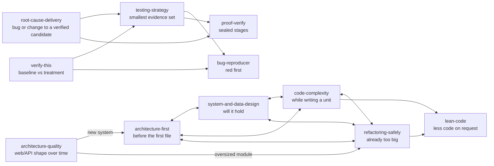

# Skills that hand the task to each other

*Development skills, wired so that the agent reaches the right one at the right moment,
and so does every subagent it starts.*

[Nine skills, one skeleton](skills-organised-by-author.md) told how nine author-shaped
architecture skills became four, cut by the moment you need them. This note is the next
step: those skills, and the ones that carry a change to a verified result, now **route to
each other**. Each one says where its job ends and which skill picks up from there, and
three mechanisms make sure that statement actually reaches the agent.

## What you get

Write code with this kit installed and the agent works from the skill for the moment it
is in, not from whichever skill the wording of your prompt happens to favour.

| Your moment | Skill | A phrase that reaches it |
|---|---|---|
| Starting something: what are the modules, which way do dependencies point | [`architecture-first`](../skills/development/architecture-first/SKILL.md) | "build a new service for invoices" |
| A web app or API that has to stay readable as pages pile up | [`architecture-quality`](../skills/development/architecture-quality/SKILL.md) | "keep the web app readable while adding this feature" |
| Will it hold, and where does the data live | [`system-and-data-design`](../skills/development/system-and-data-design/SKILL.md) | "will this hold at 10k requests per second" |
| A unit is being written and is getting hard to follow | [`code-complexity`](../skills/development/code-complexity/SKILL.md) | "this function is hard to follow, too many parameters" |
| It is already too big | [`refactoring-safely`](../skills/development/refactoring-safely/SKILL.md) | "split server.py, it is 4000 lines" |
| Less code, please | [`lean-code`](../skills/lean-code/SKILL.md) | "be lazy, simplest solution please" |
| A bug or a substantive change that must reach a verified candidate | [`root-cause-delivery`](../skills/development/root-cause-delivery/SKILL.md) | "the export crashes on empty files, fix the bug" * |
| Which tests prove this change | [`testing-strategy`](../skills/development/testing-strategy/SKILL.md) | "which tests should run for this API change" |
| Prove the claim, before and after | [`verify-this`](../skills/development/verify-this/SKILL.md) | "prove the fix works, before and after" |

Every phrase in the right-hand column was run through the real hook on 2026-10-19 and
reached exactly the skill in its row. \* The bug report is the one exception, and on
purpose: [`root-cause-delivery-guard`](../hooks/root-cause-delivery-guard.py) records
the incident itself at `UserPromptSubmit` and keeps source edits behind a frozen plan, so
it needs no advisory route.

## The hand-offs

A skill description is read by the model deciding what to load. So the boundaries are
written where that decision is made, in the description itself: *"Do NOT use for X (use
Y)."* The resulting graph:



- **The four moments form a closed set.** `architecture-first`, `system-and-data-design`,
  `code-complexity` and `refactoring-safely` each name the other three in their own
  description, with the question that belongs over there. A model that loaded the wrong
  one is told, in the text it just loaded, where to go instead.
- **`lean-code` is a destination, never a default.** Two of the four send "strip the
  over-engineering" requests there. It is the counterweight to growth, and it has its own
  counterweight: [`module-shape-advisor`](../hooks/module-shape-advisor.py) fires on the
  shape of the whole file, because the minimal diff is what looks fine every time.
- **The delivery chain is separate from the shape question.** `root-cause-delivery`
  freezes a bounded plan, demands the reproducer red before the fix and green after, and
  forces a re-triage after two failed attempts. `testing-strategy` picks the smallest
  evidence set that proves the behaviour. `verify-this` and `proof-verify` close with a
  verdict that has evidence behind it.
- **Depth stays behind the entry point.** Each skill keeps the books it was distilled
  from (Martin, Evans, Ousterhout, Fowler, Kleppmann, Hunt & Thomas) as `references/`,
  loaded only when the step asks for them.

## The three wires

A boundary written in prose is still a request. Three mechanisms make it a route:

1. **The description**, read by the client's own skill loader. It covers the full catalog
   and needs nothing from this repo except well-cut descriptions.
2. **[`keyword-skill-router`](../hooks/keyword-skill-router.py)** at `UserPromptSubmit`.
   A small curated set of high-confidence phrases in English and Russian, advisory only.
   It exists for the moments where the loader has no discriminating signal.
3. **[`agent-skill-contract`](../hooks/agent-skill-contract.py)** at delegation. A
   subagent starts from its own prompt, not yours, so the parent's routing used to stop
   at the `Task` boundary. The contract reuses the same router on the child's task and
   binds the selected skill to that exact prompt (`task-sha256`). Claude Code checks it
   crosses the `Task` boundary; on Codex the pre-hook inserts it into `spawn_agent`,
   [`subagent-skill-context`](../hooks/subagent-skill-context.py) adds the same
   discipline at `SubagentStart`, and
   [`subagent-evidence-receipt`](../hooks/subagent-evidence-receipt.py) asks the child
   for its basis and evidence before its result is accepted.

What a child receives for "split server.py, it is 4000 lines":

```text
<agent-skill-contract version="4">
route: curated
client-profile: claude
routing-source: keyword-skill-router-v1
required-skills:
- refactoring-safely
...
task-instructions-precede-skill-methodology: true
</agent-skill-contract>
```

The last line matters: the task you gave outranks the skill's method. A skill can shape
how the work is done, never shrink or redirect what was asked.

## What was broken, and is not any more

Wiring the announcement above was also an audit. Running each skill's own promised
phrasings through the hook found three places where a description promised a route the
router did not deliver:

| Phrase the skill promises | Should reach | Before |
|---|---|---|
| "will this hold", "do we need a queue", "how many machines" | `system-and-data-design` | no route |
| "be lazy", "yagni", "simplest solution", "don't over-engineer" | `lean-code` | no route |
| "split server.py, it is 4000 lines" | `refactoring-safely` | no route, so a delegated child got no skill |

All three are fixed, each with the failing case added first and negative controls that must
stay unrouted ("we need to split the database module" stays with `refactoring-safely`;
"app.py printed 500 lines of errors" routes nowhere). The router suite is 72 real hook
invocations: 32 development phrasings, 10 that must route nowhere.

## Known limits

- The router is advisory. It suggests; the model decides. A blocking router would fight
  task completion the way any blocking style gate does.
- "refactor" on its own still routes to `lean-code`. It is the one word that does not say
  which moment you are in; "split", "extract", or a file with its line count reaches
  `refactoring-safely`.
- Routing proves the skill was offered, not that it was followed. That part is the
  evidence receipt's job, and on Claude Code the subagent receipt is covered only where
  the client exposes the event.

## Try it

```bash
# install the development skills (Claude Code)
cp -r skills/development/{architecture-first,architecture-quality,system-and-data-design,code-complexity,refactoring-safely,root-cause-delivery,testing-strategy,verify-this,proof-verify,bug-reproducer} ~/.claude/skills/
cp -r skills/lean-code ~/.claude/skills/

# see the routing for yourself
python scripts/test_keyword_skill_router.py
python hooks/agent-skill-contract.py --task "split server.py, it is 4000 lines" --profile claude
python scripts/audit_skill_hook_wiring.py
```

For Codex and the shared `~/.agents` root, `scripts/sync_skills_to_codex.py --apply
--also-claude --also-agents` installs the same set with backups.
